<p align="center">
  
</p>

<p align="center">
  <a href="https://github.com/Starktastic-Homelab/ansible/actions/workflows/deploy.yml"></a>
  <a href="https://github.com/Starktastic-Homelab/ansible/actions/workflows/validate.yml"></a>
  <a href="https://github.com/Starktastic-Homelab/ansible/actions/workflows/i915-compat.yml"></a>
</p>

This repository turns the VMs that terraform clones into a K3s cluster and hands that cluster to Argo CD.
It also owns the Proxmox host under them: the Intel GPU driver that gives the workers virtual functions,
the host-side backup, the guest boot order and a serial bridge for Zigbee. A deploy takes the same
maintenance lock as terraform's apply, and a GPU driver change counts as done only after every worker
has encoded video on the new driver.

## Where it sits

<p align="center">
  
</p>

Terraform's apply sends the `repository_dispatch` event `infrastructure-changed` when it has changed the
VMs, and `deploy.yml` answers it. A push to `main` or a manual run starts the same deploy. What leaves
is a cluster running Argo CD with the root app `cluster-bootstrap` on the
[apps](https://github.com/Starktastic-Homelab/apps) repository, and the kubeconfig as the organization
secret `KUBECONFIG_RAW` for terraform and apps. The
[organization profile](https://github.com/Starktastic-Homelab) shows the whole chain.

## How it works

### One deploy, from trigger to hand-off

<p align="center">
  
</p>

`deploy.yml` has two jobs. `provision` runs on the self-hosted runner, a VM on the Proxmox host that can
reach the nodes over SSH. `handoff` runs on a GitHub-hosted runner, so the token that writes organization
secrets never touches the self-hosted machine. The kubeconfig crosses between them encrypted, because
anyone can download the artifacts of a public repository.

- **One lock for applies and deploys.** `scripts/maintenance_lock.py` records the owner on the runner's disk,
  and terraform's apply takes the same lock. A deploy releases it only after the playbook succeeds, so a
  failed run keeps the lock until someone has looked.
- **No host list.** `inventory/proxmox.yml` builds the groups `all_k3s`, `masters` and `workers` from the
  Proxmox tags that terraform sets on the VMs.
- **One API address.** Play 2 starts kube-vip on the control plane, and every other node joins through
  `10.9.9.99`.
- **Replaced workers are retired first.** Play 5 goes through the workers one at a time and deletes the
  stale Node object of a VM that was replaced, before the new agent joins.
- **Drained nodes come back last.** Terraform sends the names it drained as `drained_nodes`. Play 7 waits
  until every node is Ready, then uncordons only the listed nodes that are still in the inventory.
- **Secrets work on the first sync.** Play 8 seeds the Sealed Secrets key and restores the TLS
  certificates from their NFS backup before it installs Argo CD. From the root app on, Argo CD pulls
  `main` of apps by itself.

A newer run never cancels a deploy in progress, because an interrupted `helm upgrade` would leave a
pending release. It waits its turn instead.

### A GPU driver change, from pin to proof

<p align="center">
  
</p>

The host runs the `i915-sriov-dkms` driver, which splits the integrated GPU into seven virtual functions.
Packer bakes the guest side into the VM image, and the two sides run different releases on purpose. Every
pull request therefore runs `scripts/i915_compat.py`, the same file that packer carries, against both
pins. It reads upstream metadata and a short list of releases known to be bad. It does not test hardware.

Merging a change to `group_vars/proxmox_hosts/i915_sriov.yml` installs the driver and reboots the host a
minute later, without taking the maintenance lock, so it belongs in a maintenance window. The runner is a
VM on that host, so the workflow ends before the reboot and cannot see the result. Acceptance is a
separate run that a person starts: it compares every machine's boot ID with the baseline captured before
the install, and runs encode probes on every worker. The version policy, the recovery steps and the
acceptance modes are in [docs/i915-sriov.md](docs/i915-sriov.md).

### Backups that leave the host

<p align="center">
  
</p>

The `proxmox_backup` role installs `homelab-backup`, a script around restic, with three systemd timers.
The volumes reach the host as raw, still encrypted ZFS replicas on a portable USB pool. The photo library
is too large for that disk, so restic reads it over a read-only NFS mount instead. A backup run uploads
nothing when a replica is more than 8 hours old or a kernel crash record is waiting to be read.

TrueNAS is not configured from here. Each deploy of the role reads its replication, snapshot tasks and NFS
shares through the guest agent and fails if they differ from what the role expects. The restore paths and
the drills that tested them are in [docs/backup-and-restore.md](docs/backup-and-restore.md).

## What is in the repo

| Path | What it holds |
|---|---|
| `k3s.yml` | The cluster playbook: eight plays, from waiting for SSH to the Argo CD root app |
| `i915-sriov.yml`, `i915-acceptance.yml` | Host GPU driver install, and the capture and acceptance checks around it |
| `proxmox-backup.yml`, `proxmox-guest-startup.yml`, `ser2net.yml` | Host playbooks, each deployed by its own workflow |
| `proxmox-csi-storage.yml`, `csi-activation-preflight.yml`, `maintenance-runner.yml` | Manual setup and checks for Proxmox CSI storage and the runner |
| `roles/` | The 12 roles listed below |
| `inventory/` | `proxmox.yml`, the dynamic inventory from Proxmox tags, and `hosts.yml`, the Proxmox host |
| `group_vars/` | K3s version, API address, NFS, CSI topology and the host driver pin; `all/secrets.yml` is an Ansible Vault file |
| `scripts/` | `maintenance_lock.py`, `i915_compat.py`, `i915_acceptance.py`, the GPU probe, secrets backup and restore, and the offline tests in `scripts/tests/` |
| `docs/` | Runbooks and qualification records |

| Role | Runs on | What it does |
|---|---|---|
| `k3s_common` | every K3s node, as a dependency | Kernel settings, registry credentials, a resolver for pods, the node config with its CSI topology labels, and the K3s install script |
| `k3s_init` | first control-plane node | Starts the first K3s server with `--cluster-init`, deploys kube-vip, copies the kubeconfig to the runner |
| `k3s_masters` | further control-plane nodes | Joins them through the kube-vip address |
| `k3s_node_retirement` | workers, one at a time | Deletes the Node object of a replaced worker VM, after checking the Proxmox API and the maintenance lock |
| `k3s_workers` | workers | Joins the agents and applies the worker and GPU labels |
| `bootstrap_cluster` | the runner | CSI topology labels, a second CoreDNS replica, the Sealed Secrets key, the TLS restore, the helm-diff pin, Argo CD and its root app |
| `i915_sriov` | Proxmox host | Installs the DKMS driver, pins the kernel, sets the boot parameters and the seven virtual functions, schedules the reboot |
| `proxmox_backup` | Proxmox host | The backup script and timers, the USB pool import, the vzdump job, a storage quota and the TrueNAS drift check |
| `proxmox_guest_startup` | Proxmox host | Starts TrueNAS first and waits for it, reboots the host after a kernel oops, caps the ZFS ARC, pins the runner's memory, installs CPU microcode |
| `ser2net` | Proxmox host | Exposes the Zigbee USB dongle on TCP port 3333 |
| `proxmox_csi_storage` | Proxmox host, by hand | Registers the NFS storage, resource pool, role and API token for Proxmox CSI, and refuses anything that already differs |
| `maintenance_runner` | the runner VM, by hand | Creates the maintenance directory and the marker that identifies this runner |

## Workflows

| Workflow | Runs on | What it does |
|---|---|---|
| `deploy.yml` | dispatch from terraform, push to `main`, manual | Runs the K3s playbook under the maintenance lock, installs Argo CD, hands the kubeconfig to terraform and apps |
| `validate.yml` | pull request, manual | Lint, syntax check and the offline test suites |
| `i915-compat.yml` | pull request, manual | Checks the host GPU driver pin against the guest pin in packer; can call `i915-acceptance.yml` |
| `format.yml` | pull request | Formats YAML and JSON, and commits the result |
| `i915-sriov-upgrade.yml` | push that changes the host driver pin, manual | Installs the host GPU driver, then reboots the host |
| `proxmox-backup.yml` | push that changes the backup role, manual | Deploys the host-side backup |
| `proxmox-guest-startup.yml` | push that changes the startup role, manual | Sets guest boot order and the host's crash behaviour |
| `ser2net.yml` | push that changes the ser2net role, manual | Deploys the Zigbee serial bridge |
| `i915-acceptance.yml` | manual, or called | Proves GPU acceleration works on the running stack or after a reboot |
| `csi-activation-preflight.yml` | manual | Read-only check before changing Proxmox CSI storage |

Everything that talks to the host or the cluster runs on the self-hosted runner. `format.yml`, the lint
job of `validate.yml`, the metadata job of `i915-compat.yml` and the `handoff` job of `deploy.yml` run on
GitHub-hosted runners.

## Run it

CI runs in `python:3.14-trixie`; this Ansible release does not import under Python 3.15.

```sh
pip install -r requirements.txt
ansible-galaxy collection install -r requirements.yml
```

The offline checks need no host and no secrets. `ansible-lint` only needs a `.vault_pass` file to exist;
CI writes a dummy one.

```sh
python3 -m unittest discover -s scripts/tests -p 'test_maintenance*.py' -v
python3 scripts/tests/test_i915_compat.py
pip install ansible-lint && ansible-lint --offline
```

The playbooks need the `PROXMOX_*` variables for the dynamic inventory, the vault password, the SSH key
and, for `k3s.yml`, Helm. The workflows run them like this, under the maintenance lock where it applies:

```sh
ansible-playbook -i inventory/proxmox.yml --vault-password-file .vault_pass --private-key private_key.pem k3s.yml
ansible-playbook -i inventory/hosts.yml --vault-password-file .vault_pass proxmox-backup.yml
```

GPU acceptance, on the running stack or after a driver upgrade:

```sh
gh workflow run i915-acceptance.yml -f mode=current-stack
gh workflow run i915-acceptance.yml -f mode=post-reboot -f installation_run_id=<upgrade run ID>
```

## Operations

- [Backup and restore](docs/backup-and-restore.md): schedules, retention, every restore path and the drills.
- [Intel i915 SR-IOV](docs/i915-sriov.md): why host and guest versions differ, host-driver recovery, acceptance modes.
- [Maintenance coordination](docs/maintenance-coordination.md): the shared lock, drain recovery, node retirement, recovering a failed run, the Proxmox CSI bootstrap.
- [Proxmox CSI storage](docs/proxmox-csi-storage.md): the manual storage, pool and token setup.
- [Maintenance execution exclusion](docs/maintenance-execution.md): the per-runner execution mutex in the lock helper.
- [Runner qualification, 2026-09-21](docs/maintenance-runner-qualification-2026-09-21.md): the record for the maintenance runner.
- [Supervised executor](docs/maintenance-executor.md) and its [qualification](docs/maintenance-executor-qualification-2026-09-30.md): historical, the executor is retired.
- [Operator scripts](scripts/README.md): kubeconfig fetch and the secrets backup for disaster recovery.
- [Security policy](SECURITY.md): how to report a vulnerability.

---

<p align="center">
  Part of <a href="https://github.com/Starktastic-Homelab"><b>Starktastic Homelab</b></a>:
  <a href="https://github.com/Starktastic-Homelab/packer">packer</a> ·
  <a href="https://github.com/Starktastic-Homelab/terraform">terraform</a> ·
  <a href="https://github.com/Starktastic-Homelab/ansible">ansible</a> ·
  <a href="https://github.com/Starktastic-Homelab/apps">apps</a><br>
  <sub>Product logos in the diagrams are trademarks of their owners and are used only to label the components.</sub>
</p>
