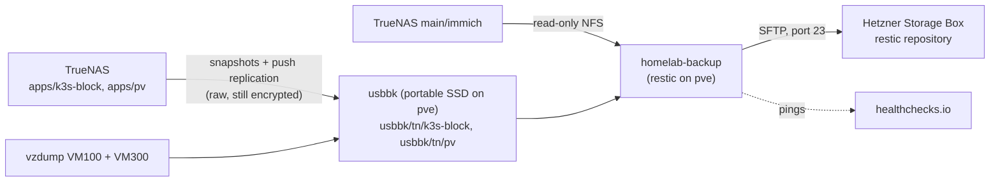

# Backup and restore

Operator runbook for the host-side backup managed by the `proxmox_backup` role (`proxmox-backup.yml`). Run every
command as root on `pve` unless a step says otherwise. Live Kubernetes steps (scaling an app) run from the runner.

## Overview



- **Local copy (6 h RPO):** TrueNAS snapshots `apps/k3s-block` and `apps/pv` and pushes them over SSH (user
  `tnrepl`) into the encrypted pool `usbbk`. The replicas are raw sends, read-only, and need `apps.key` to mount.
  vzdump writes VM100 and VM300 to `usbbk-vz` (`/usbbk/vz/dump`, uncompressed `.vma`).
- **Immich:** its originals are not on `usbbk`. Local history is the TrueNAS snapshots of `main/immich`; the
  off-site copy is restic reading the share live over a read-only NFS mount (originals are write-once).
- **Off-site copy (24 h RPO):** `/usr/local/sbin/homelab-backup backup` refuses a replica older than 8 h, mounts
  the newest `auto-*` snapshot of each replica read-only under `/srv/backup-src/`, mirrors the five repos into
  `/usbbk/git`, and uploads three restic snapshots, each with `--host pve`:

| Tag | Contents |
|---|---|
| `daily` | `/srv/backup-src/{k3s-block,pv}`, `/etc` (including `/etc/pve`), `/usbbk/git`, `/root`; minus `/etc/homelab-backup` and the excludes in `/etc/homelab-backup.d/excludes.txt` (five regenerable images, Immich `thumbs/` and `encoded-video/`) |
| `vzdump` | the newest `vzdump-qemu-300-*.vma` (Garage Terraform state). The VM100 dump stays local. |
| `nfs` | `/srv/backup-src/immich`, uploaded last so a broken share can't hold back the others |

- **Deletion protection:** Storage Box automatic snapshots, weekly, managed only from the Hetzner Console.

### Schedules (Asia/Jerusalem)

| What | When |
|---|---|
| pg-backup, Immich DB dump | 02:00 daily |
| cert-backup | 03:00 daily |
| TrueNAS snapshots: apps / `main/immich` | :30 / :45 of 03, 09, 15, 21 |
| TrueNAS snapshot `main/media` (local only) | 04:00 daily |
| vzdump VM100 + VM300 | Sun 01:00 |
| `homelab-backup-backup.timer` | 04:30 daily |
| `homelab-backup-maint.timer` | Sun 05:30 |
| `homelab-backup-health.timer` | hourly |
| Storage Box automatic snapshot | Sun 06:00, 10 slots |

### Retention

| Copy | Kept |
|---|---|
| restic `daily`, `nfs` | `--keep-daily 14 --keep-weekly 8 --keep-monthly 12` |
| restic `vzdump` | `--keep-last 2` |
| `usbbk/tn` replicas | 2 weeks (TrueNAS replication, custom) |
| TrueNAS apps snapshots / `main/immich` / `main/media` | 1 week / 2 weeks / 1 week |
| vzdump on `usbbk-vz` | keep-last 3 |

`maint` forgets by tag, prunes, then runs `restic check --read-data-subset 5%`.

### Checks the backup refuses or flags

- **Refuses (nothing uploaded):** a kernel crash record in `/var/lib/systemd/pstore`, `usbbk` not ONLINE,
  `usbbk/cache` not mounted, or a replica snapshot over 8 h old.
- **Uploads but pings `/fail`:**
  - `pg_dumpall_*.sql.gz`, `immich-db-backup-*.sql.gz` or cert-backup `*.yaml` that is missing, empty or older
    than 26 h
  - a VM100 or VM300 vzdump older than 8 days
  - a failed git mirror
  - an Immich share that won't mount or lacks `upload/.immich`
  - restic exit 3: the snapshot was written without the files it couldn't read

### Alerting

healthchecks.io gets `/start`, then success or `/fail` with the last 50 log lines. Email is the only channel.

| Check | Sent by | Period | Grace |
|---|---|---|---|
| `pve-backup` | `homelab-backup backup` | 1 d | 6 h |
| `pve-backup-maint` | `homelab-backup maint` | 7 d | 1 d |
| `pve-health` | `homelab-backup health`: pools, replica age, recent crash records | 1 h | 2 h |
| `alertmanager-watchdog` | Alertmanager's `Watchdog` (apps repo), about every 2 min | 5 min | 5 min |

The last one is the dead-man's switch for in-cluster alerting. TrueNAS replication failures arrive as TrueNAS
email.

```bash
systemctl list-timers 'homelab-backup-*'
journalctl -u homelab-backup@backup.service --since today
journalctl -u homelab-backup@backup.service | grep -E 'PROBLEM|Added to the repository'
```

## Secrets

All five live only in `/etc/homelab-backup/` on `pve` (directory `0700`, files `0600`, root). They never go in
git, Ansible Vault, CI or logs, and restic excludes the directory. The role checks they exist and refuses loose
modes; it never creates them. Place a lost one by hand from Ben's copy.

| File | What |
|---|---|
| `restic.pass` | restic repository password |
| `id_storagebox` | SSH key for the Storage Box sub-account |
| `healthchecks.env` | ping URLs as `HC_BACKUP=`, `HC_MAINT=`, `HC_HEALTH=` |
| `apps.key` | TrueNAS `apps` encryption key (opens the raw replicas) |
| `usbbk.key` | `usbbk` pool key (hex) |

Ben keeps copies in iCloud Keychain, together with the Storage Box sub-account password, the Hetzner login and
2FA recovery codes, the Ansible Vault password and the GitHub recovery codes. The key kit
(`truenas-keykit-<date>.tar.gpg` in iCloud Drive, passphrase in Keychain) holds the TrueNAS config and the apps
key. A paper copy of the restic password is planned but not confirmed.

Non-secret settings (Storage Box host, user and pinned host key, sources, excludes) are role variables in
`roles/proxmox_backup/defaults/main.yml`, rendered into `/etc/homelab-backup.d/`.

## Hold the backup lock

`backup` and `maint` take `/run/lock/homelab-backup.lock`; `health` does not. Hold the same lock for any manual
restic work or replica mount, so a timer run waits instead of colliding with you. A timer run that waits spends its
23 h start timeout, so don't hold the lock across 04:30 or Sunday 05:30 for long. Use a separate root shell:

```bash
exec 9>/run/lock/homelab-backup.lock
flock -n 9 || { echo "a backup or maint run holds the lock; retry later"; exit 1; }
# ... work in this shell; the lock is released when it exits
```

If `flock` fails, the shell exits: don't go on with restic work or mounts until you hold the lock.

Keep your own mounts out of `/srv/backup-src/`: every `backup` run unmounts whatever it finds there.

## Run restic by hand

Use the same invocation as `homelab-backup` and the restore test: the role's SSH alias, the repository from
`sources.json`, the password file, and the cache on `usbbk`.

```bash
R() { restic -o "sftp.command=ssh -F /etc/homelab-backup.d/ssh_config storagebox -s sftp" \
  -r "$(python3 -c 'import json;print(json.load(open("/etc/homelab-backup.d/sources.json"))["repository"])')" \
  --password-file /etc/homelab-backup/restic.pass --cache-dir /usbbk/cache "$@"; }

R snapshots
R snapshots --tag nfs
R ls latest --tag daily /srv/backup-src/k3s-block/images/9999
R stats
```

To run a whole backup or maintenance pass outside the timer (the unit is `Type=oneshot`, so without `--no-block`
`systemctl start` waits for the whole run):

```bash
systemctl start --no-block homelab-backup@backup.service   # or @maint, @health
journalctl -fu homelab-backup@backup.service
```

## Restore paths

**Pick a snapshot from a green run.** A run that hit restic exit 3 still writes a snapshot, minus the unreadable
files, and it becomes `latest`. Match the snapshot time to a success on healthchecks.io, or check that run's journal
has no `PROBLEM` line, and restore by snapshot ID, not `latest`. Check free space on `usbbk` before any restore into
`/usbbk/restore`.

### One image from the replica

The fastest path: up to 2 weeks of 6-hourly history, on the same host. Copy the image byte for byte under its
original name, so the startup guards accept it. This path has not been drilled as a full restore into a live app.

1. From the runner, scale the app to 0 and wait until its pod is gone and its volume is detached.
2. Mount a replica snapshot read-only (hold the lock):

   ```bash
   zfs list -t snapshot -o name,creation -r usbbk/tn/k3s-block | tail
   [ "$(zfs get -H -o value keystatus usbbk/tn/k3s-block)" = available ] || \
     zfs load-key -L file:///etc/homelab-backup/apps.key usbbk/tn/k3s-block
   mkdir -p /srv/restore-src
   mount -t zfs -o ro usbbk/tn/k3s-block@auto-<date> /srv/restore-src
   ```

3. Copy it over the live image, then compare. **This overwrites the live image.** Check `<name>` and that
   `$live` is the scaled-down app's volume first, and keep a rollback copy until the app is verified:

   ```bash
   live=$(pvesm path k3s-block:9999/vm-9999-<name>.raw)
   ls -ls "$live"
   cp --sparse=always "$live" "$live.pre-restore"   # remove once the app is verified
   cp --sparse=always /srv/restore-src/images/9999/vm-9999-<name>.raw "$live"
   sha256sum /srv/restore-src/images/9999/vm-9999-<name>.raw "$live"
   umount /srv/restore-src
   ```

4. Scale the app back up. For `apps/pv` data, mount `usbbk/tn/pv@auto-<date>` the same way and copy files back.

### One image from restic

Measured 2026-11-13: `vm-9999-postgres.raw` (16 GiB, sparse) in 53 s, `vm-9999-immich-postgres.raw` (10 GiB) in
32 s. That is the single-volume RTO from the Storage Box.

```bash
R snapshots --tag daily
R restore <snapshot-id> --target /usbbk/restore --sparse \
  --include /srv/backup-src/k3s-block/images/9999/vm-9999-<name>.raw
ls -ls /usbbk/restore/srv/backup-src/k3s-block/images/9999/
```

Then put it in place as in steps 1, 3 and 4 above (including the rollback copy), copying from `/usbbk/restore/srv/backup-src/...`, and remove
the restored copy afterwards. Files from `apps/pv` restore the same way from `/srv/backup-src/pv/...`.

### Whole apps-pool loss

**Untested.** The plan is to move `usbbk` into TrueNAS (VM100) by USB passthrough and send the replicas back; the
pool was created with `compatibility=openzfs-2.3-linux` so TrueNAS's OpenZFS 2.3 can import it. Neither the import
inside VM100 nor a 2.4 to 2.3 send has been tried. Outline:

1. On `pve`: stop the backup timers, unmount and `zpool export usbbk`.
2. Pass the disk's USB device through to VM 100 (`qm set 100 -usb0 host=<vendor>:<product>`).
3. On TrueNAS: import `usbbk`, load its key from `usbbk.key`, then send each replica's newest snapshot raw
   (`zfs send -w`) into a new `apps` pool. The received datasets keep the `apps` encryption, so they open with the
   key kit's apps key. Clear `readonly` on the restored datasets.
4. Hand the disk back to `pve`, re-run the role, and check the replication task before relying on it.

If `usbbk` is lost too, restore the images from restic tag `daily` instead.

### Immich

- **A file or folder, `main` intact:** copy it from a TrueNAS snapshot (2 weeks, 6-hourly), on TrueNAS as root,
  keeping ownership `1000:3000`:

  ```bash
  # on TrueNAS
  ls /mnt/main/immich/.zfs/snapshot/
  cp -a /mnt/main/immich/.zfs/snapshot/<snap>/upload/<path> /mnt/main/immich/upload/<path>
  ```

- **`main` lost:** restore from restic tag `nfs` (a green run's snapshot) into space that can hold it, then copy it
  into the rebuilt `main/immich` owned `1000:3000`. The 2026-11-13 test restored 50 originals (in 20 s), not a
  whole library.

  ```bash
  R snapshots --tag nfs
  R restore <snapshot-id>:/srv/backup-src/immich --target /usbbk/restore/immich
  ```

  The excludes drop `thumbs/` and `encoded-video/`, and Immich's folder check won't start without their markers.
  Recreate them in the restored library, then run the **missing** Generate Thumbnails and Transcode Videos jobs in
  Immich's admin Jobs page:

  ```bash
  install -d -o 1000 -g 3000 <library>/thumbs <library>/encoded-video
  install -o 1000 -g 3000 -m 0644 /dev/null <library>/thumbs/.immich
  install -o 1000 -g 3000 -m 0644 /dev/null <library>/encoded-video/.immich
  ```

  The Immich database comes from `backups/immich-db-backup-*.sql.gz` in the same snapshot, or from the
  `vm-9999-immich-postgres.raw` image in tag `daily`.

### First upload of a large repository

The timer's unit stops a run after 23 h. A first upload, or a share that has grown past what uploads in a day, runs
under `systemd-run` instead. Stop the backup timer first: a timer run queued on the lock would spend its timeout
waiting and be killed mid-upload. The first upload on 2026-11-09 stored 161 GiB in about 2 h (~205 Mbit/s).

```bash
systemctl stop homelab-backup-backup.timer
systemd-run --unit=homelab-backup-first -p Nice=10 -p IOSchedulingClass=idle /usr/local/sbin/homelab-backup backup
journalctl -fu homelab-backup-first
# after it exits 0 with no PROBLEM line:
systemctl start homelab-backup-backup.timer
```

A role deploy also starts the timer again, so don't merge `proxmox_backup` changes during the upload.

### Off-site-only DR from the key kit

For when `pve`, TrueNAS and `usbbk` are all gone. Not yet drilled end to end; the restic password from Keychain
alone has opened the repository (2026-11-09, from `pve`).

1. On a fresh machine with restic and ssh, take the host and user from `proxmox_backup_storagebox_host` and
   `proxmox_backup_storagebox_user`. Check the host key before trusting it; the ED25519 fingerprint must be
   Hetzner's published `SHA256:XqONwb1S0zuj5A1CDxpOSuD2hnAArV1A3wKY7Z3sdgM`:

   ```bash
   SB_HOST=<proxmox_backup_storagebox_host> SB_USER=<proxmox_backup_storagebox_user>
   ssh-keyscan -p 23 -t ed25519 "$SB_HOST" | ssh-keygen -lf -
   ```

2. Add a new key with the sub-account password from Keychain, and an SSH alias that uses it:

   ```bash
   ssh-keygen -t ed25519 -f ~/.ssh/id_storagebox_dr
   ssh -p 23 "$SB_USER@$SB_HOST" install-ssh-key < ~/.ssh/id_storagebox_dr.pub
   cat >> ~/.ssh/config <<EOF
   Host storagebox
     HostName $SB_HOST
     User $SB_USER
     Port 23
     IdentityFile ~/.ssh/id_storagebox_dr
     IdentitiesOnly yes
   EOF
   ```

3. List the snapshots with the restic password from Keychain in a `0600` file. `R()` only works on `pve` (it reads
   `/etc/homelab-backup*`), so define it here with the new alias and password file, then restore as above:

   ```bash
   R() { restic -o "sftp.command=ssh storagebox -s sftp" -r sftp:storagebox:repo \
     --password-file ~/restic.pass "$@"; }
   R snapshots
   ```

4. Rebuild in order: TrueNAS from the key kit's config, then `pve` from `/etc` in tag `daily` and this repo, then
   the cluster from git (the mirrors are in tag `daily` under `/usbbk/git`), the volumes from tag `daily`, Immich
   from tag `nfs`, and Garage's Terraform state from the VM300 dump in tag `vzdump`.

If the repository itself was wiped, the weekly Storage Box snapshots under `/.zfs/snapshot/` are read-only copies
of it (restore one in the Hetzner Console). Reading a repository straight from there is untested.

Known gaps:

- **Stale TrueNAS config:** the key kit holds the 2026-11-08 export, and nothing refreshes it; the VM100 dump stays
  local. Re-run `truenas-keykit-export.py` after any TrueNAS config change and at each drill.
- **`apps/iscsi`** (the retired Jellyfin ZVOL, kept by `jellyfin-storage-hold`) has no replica and no off-site
  copy. Ben decides whether to accept its loss or retire it.
- **vzdump keep-last 2** keeps a complete VM300 dump through one failed upload before Sunday's maint, not two: a
  dump that stays unreadable into the next Sunday, or a failing manual re-run between Sunday's 04:30 `/fail` and
  the 05:30 maint, leaves only incomplete snapshots. After a vzdump `/fail`, fix the cause before the next Sunday,
  and don't re-run backup by hand in that Sunday window.

### The five excluded images

`vm-9999-{prometheus,loki,tempo,alertmanager,karakeep-meilisearch}.raw` have no off-site copy (they are in the
replica). After a loss they need re-initialisation as empty volumes. **TODO:** that runbook is still to write.

## After a kernel crash

`proxmox_guest_startup` makes the host reboot 10 s after a kernel oops (`kernel.panic_on_oops=1`,
`kernel.panic=10`) and panic on a failed ZFS assertion (`spl_panic_halt=1`). Before that, the 2026-11-10 ZFS
`arc_evict` oops during a backup left the host hung for 4.5 h. At boot systemd-pstore archives the crash record in
`/var/lib/systemd/pstore`, and `proxmox_backup` overrides systemd's 14-day cleanup of it
(`/etc/tmpfiles.d/systemd-pstore.conf`).

- **Guard:** `backup` and `maint` refuse (and ping `/fail`) while any record is there, so a crash the backup sets
  off costs one reboot, not one every night. `health` counts only records under 3 h old, so it alerts once and then
  reports other problems again; `pve-backup` stays red until you clear the record.
- **After any hang or unexpected reboot, read pstore first:**

  ```bash
  uptime
  ls -l /var/lib/systemd/pstore/
  cat /var/lib/systemd/pstore/<id>/*/dmesg.txt
  journalctl -k -b -1 | tail -100
  ```

- **Resume:** copy the record off the host, remove it, then start one backup while watching the kernel log
  (`--no-block` so `journalctl -kf` runs during the backup; follow the unit with `journalctl -fu
  homelab-backup@backup.service` in a second shell):

  ```bash
  mkdir -p /root/incident-<date>
  tar -C /var/lib/systemd/pstore -czf /root/incident-<date>/pstore-<id>.tar.gz <id>
  # copy the tarball to the workstation, then:
  rm -r /var/lib/systemd/pstore/<id>
  systemctl start --no-block homelab-backup@backup.service
  journalctl -kf
  ```

## Restore drill

### Quarterly test

The checklist below is the procedure. The 2026-11-13 run did it as one script under `systemd-run` that held the
backup lock (`flock -n`), restored into `/usbbk/restore`, compared and removed the copies; it passed with both images
and all 50 originals matching. That script is not in this repo: it pins one run's snapshot IDs.

- [ ] Check free space on `usbbk` and pick a `daily` and an `nfs` snapshot from runs that healthchecks shows green.
- [ ] Restore `vm-9999-postgres.raw` and `vm-9999-immich-postgres.raw` with `--sparse`, and time each. Compare
      with the 53 s and 32 s baseline.
- [ ] Their `sha256` equals the same file in the replica snapshot that run read (mounted read-only).
- [ ] PG system identifiers: attach each image with `losetup -r -P`, mount it `ro,noload` (`ro,norecovery` for
      XFS), and `od -An -t u8 -N8 <pgdata>/global/pg_control` prints `7584099661242523698` (postgres) and
      `7614955115223928876` (immich-postgres).
- [ ] 50 random Immich originals from tag `nfs` are byte-identical (`cmp`) to the live share on a read-only mount.
- [ ] SQLite `integrity_check` on an app database from tag `daily` (in the design, not yet run).
- [ ] Remove the restored copies; no mounts or loop devices left; `journalctl -k` clean.
- [ ] Re-run `truenas-keykit-export.py` and store the new kit.
- [ ] Record the times here.

### Yearly DR drill

From a machine that is not `pve`, with only Keychain and the key kit: run the off-site-only DR steps above, open
the key kit, restore one image and a few Immich originals, and check them as in the quarterly test. Not yet done.
