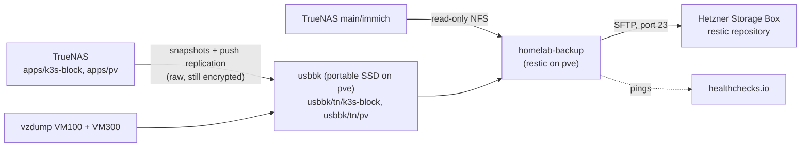

# Backup and restore

Operator runbook for the host-side backup managed by the `proxmox_backup` role (`proxmox-backup.yml`). Run every
command as root on `pve` unless a step says otherwise. Live Kubernetes steps (scaling an app) run from the runner.

## Overview



- **Local copy (6 h RPO):** TrueNAS snapshots `apps/k3s-block` and `apps/pv` and pushes them over SSH (user
  `tnrepl`) into the encrypted pool `usbbk`. The replicas are raw sends, read-only, and need `apps.key` to mount.
  vzdump writes VM100 and VM300 to `usbbk-vz` (`/usbbk/vz/dump`, uncompressed `.vma`).
- **Immich:** its originals are not on `usbbk`. Local history is the TrueNAS snapshots of `main/immich`; the
  off-site copy is restic reading the share live over a read-only NFS mount (originals are write-once).
- **Off-site copy (24 h RPO):** `/usr/local/sbin/homelab-backup backup` refuses a replica older than 8 h, mounts
  the newest `auto-*` snapshot of each replica read-only under `/srv/backup-src/`, mirrors the five repos into
  `/usbbk/git`, and uploads three restic snapshots, each with `--host pve`:

| Tag | Contents |
|---|---|
| `daily` | `/srv/backup-src/{k3s-block,pv}`, `/etc` (including `/etc/pve`), `/usbbk/git`, `/root`; minus `/etc/homelab-backup` and the excludes in `/etc/homelab-backup.d/excludes.txt` (five images re-initialised blank after a loss, see **Re-initialise an excluded image**; Immich `thumbs/` and `encoded-video/`; until the ADR 0017 lab ends, the lab's `images/9970`) |
| `vzdump` | the newest `vzdump-qemu-300-*.vma` (Garage Terraform state). The VM100 dump stays local. |
| `nfs` | `/srv/backup-src/immich`, uploaded last so a broken share can't hold back the others |

- **Deletion protection:** Storage Box automatic snapshots, weekly, managed only from the Hetzner Console.

### Schedules (Asia/Jerusalem)

| What | When |
|---|---|
| pg-backup, Immich DB dump | 02:00 daily |
| cert-backup | 03:00 daily |
| TrueNAS snapshots: apps / `main/immich` | :30 / :45 of 03, 09, 15, 21 |
| TrueNAS snapshot `main/media` (local only) | 04:00 daily |
| vzdump VM100 + VM300 | Sun 01:00 |
| `homelab-backup-backup.timer` | 04:30 daily |
| `homelab-backup-maint.timer` | Sun 05:30 |
| `homelab-backup-health.timer` | hourly |
| Storage Box automatic snapshot | Sun 06:00, 10 slots |

### Retention

| Copy | Kept |
|---|---|
| restic `daily`, `nfs` | `--keep-daily 14 --keep-weekly 8 --keep-monthly 12` |
| restic `vzdump` | `--keep-last 2` |
| `usbbk/tn` replicas | 2 weeks (TrueNAS replication, custom) |
| TrueNAS apps snapshots / `main/immich` / `main/media` | 1 week / 2 weeks / 1 week |
| vzdump on `usbbk-vz` | keep-last 3 |

`maint` forgets by tag, prunes, then runs `restic check --read-data-subset 5%`.

### Settings outside restic

The role manages two `pve` settings: the vzdump job `backup-f56bebaa-4912` (VM100 + VM300, Sun 01:00, snapshot
mode, `compress 0`, keep-last 3, storage `usbbk-vz`, notes `{{guestname}}`) and the `quota=150G` on
`rpool/var-lib-vz` (storage `local`, `/var/lib/vz`). It sets the job's `enabled` only when it creates the job, so
a disable in the Proxmox UI sticks, and it refuses to create a second job that covers VM100 or VM300.

The TrueNAS side is not managed. When `proxmox_backup_enabled` is true, each `proxmox-backup.yml` deploy reads it
read-only through the VM100 guest agent and fails if it differs from `proxmox_backup_truenas_expected`:

- replication `apps to pve usbbk`: push over SSH with credential `pve-tnrepl`, `apps/k3s-block` and `apps/pv` to
  `usbbk/tn`, automatic, custom retention 2 weeks, readonly set, properties sent minus `quota`, `reservation` and
  `refreservation`, no re-encryption, no replication from scratch, `exclude` empty
- the snapshot tasks of `apps/pv`, `apps/k3s-block`, `main/media` and `main/immich`: full schedule, retention,
  recursive, naming `auto-%Y-%m-%d_%H-%M`, allow empty, enabled and `exclude` empty. `apps/pv` (recursive) and
  `apps/k3s-block` run at :30 of 03, 09, 15, 21, kept 1 week; `main/media` at 04:00, 1 week; `main/immich` at :45
  of 03, 09, 15, 21, 2 weeks; all every day, 00:00-23:59
- exactly two NFS shares on `/mnt/main/immich`, both enabled, `mapall media:media`, no `maproot`, no host list and
  default security: read-write for `10.9.8.0/24`, read-only for `10.9.9.20/32` (`pve`)
- NFS `bindip` includes `10.9.8.30` and `10.9.9.30`

Make TrueNAS changes by hand in its UI, then update `proxmox_backup_truenas_expected`. A rebuilt TrueNAS gets them
back from the config export in the key kit, which is older than some changes: see **Stale TrueNAS config** under
the off-site-only DR known gaps.

### Checks the backup refuses or flags

- **Refuses (nothing uploaded):** a kernel crash record in `/var/lib/systemd/pstore`, `usbbk` not ONLINE,
  `usbbk/cache` not mounted, or a replica snapshot over 8 h old.
- **Uploads but pings `/fail`:**
  - `pg_dumpall_*.sql.gz`, `immich-db-backup-*.sql.gz` or cert-backup `*.yaml` that is missing, empty or older
    than 26 h
  - a VM100 or VM300 vzdump older than 8 days
  - a failed git mirror
  - an Immich share that won't mount or lacks `upload/.immich`
  - restic exit 3: the snapshot was written without the files it couldn't read

### Alerting

healthchecks.io gets `/start`, then success or `/fail` with the last 50 log lines. Email is the only channel.

| Check | Sent by | Period | Grace |
|---|---|---|---|
| `pve-backup` | `homelab-backup backup` | 1 d | 6 h |
| `pve-backup-maint` | `homelab-backup maint` | 7 d | 1 d |
| `pve-health` | `homelab-backup health`: pools, replica age, recent crash records | 1 h | 2 h |
| `alertmanager-watchdog` | Alertmanager's `Watchdog` (apps repo), about every 2 min | 5 min | 5 min |

The last one is the dead-man's switch for in-cluster alerting. TrueNAS replication failures arrive as TrueNAS
email.

```bash
systemctl list-timers 'homelab-backup-*'
journalctl -u homelab-backup@backup.service --since today
journalctl -u homelab-backup@backup.service | grep -E 'PROBLEM|Added to the repository'
```

## Secrets

All five live only in `/etc/homelab-backup/` on `pve` (directory `0700`, files `0600`, root). They never go in
git, Ansible Vault, CI or logs, and restic excludes the directory. The role checks they exist and refuses loose
modes; it never creates them. Place a lost one by hand from Ben's copy.

| File | What |
|---|---|
| `restic.pass` | restic repository password |
| `id_storagebox` | SSH key for the Storage Box sub-account |
| `healthchecks.env` | ping URLs as `HC_BACKUP=`, `HC_MAINT=`, `HC_HEALTH=` |
| `apps.key` | TrueNAS `apps` encryption key (opens the raw replicas) |
| `usbbk.key` | `usbbk` pool key (hex) |

Ben keeps copies in iCloud Keychain, together with the Storage Box sub-account password, the Hetzner login and
2FA recovery codes, the Ansible Vault password and the GitHub recovery codes. The key kit
(`truenas-keykit-<date>.tar.gpg` in iCloud Drive, passphrase in Keychain) holds the TrueNAS config and the apps
key. A paper copy of the restic password is planned but not confirmed.

Non-secret settings (Storage Box host, user and pinned host key, sources, excludes) are role variables in
`roles/proxmox_backup/defaults/main.yml`, rendered into `/etc/homelab-backup.d/`.

## Hold the backup lock

`backup` and `maint` take `/run/lock/homelab-backup.lock`; `health` does not. Hold the same lock for any manual
restic work or replica mount, so a timer run waits instead of colliding with you. A timer run that waits spends its
23 h start timeout, so don't hold the lock across 04:30 or Sunday 05:30 for long. Use a separate root shell:

```bash
exec 9>/run/lock/homelab-backup.lock
flock -n 9 || { echo "a backup or maint run holds the lock; retry later"; exit 1; }
# ... work in this shell; the lock is released when it exits
```

If `flock` fails, the shell exits: don't go on with restic work or mounts until you hold the lock.

Keep your own mounts out of `/srv/backup-src/`: every `backup` run unmounts whatever it finds there.

## Run restic by hand

Use the same invocation as `homelab-backup` and the restore test: the role's SSH alias, the repository from
`sources.json`, the password file, and the cache on `usbbk`.

```bash
R() { restic -o "sftp.command=ssh -F /etc/homelab-backup.d/ssh_config storagebox -s sftp" \
  -r "$(python3 -c 'import json;print(json.load(open("/etc/homelab-backup.d/sources.json"))["repository"])')" \
  --password-file /etc/homelab-backup/restic.pass --cache-dir /usbbk/cache "$@"; }

R snapshots
R snapshots --tag nfs
R ls latest --tag daily /srv/backup-src/k3s-block/images/9999
R stats
```

To run a whole backup or maintenance pass outside the timer (the unit is `Type=oneshot`, so without `--no-block`
`systemctl start` waits for the whole run):

```bash
systemctl start --no-block homelab-backup@backup.service   # or @maint, @health
journalctl -fu homelab-backup@backup.service
```

## Restore paths

**Pick a snapshot from a green run.** A run that hit restic exit 3 still writes a snapshot, minus the unreadable
files, and it becomes `latest`. Match the snapshot time to a success on healthchecks.io, or check that run's journal
has no `PROBLEM` line, and restore by snapshot ID, not `latest`. Check free space on `usbbk` before any restore into
`/usbbk/restore`.

### One image from the replica

The fastest path: up to 2 weeks of 6-hourly history, on the same host. Copy the image byte for byte under its
original name, so the startup guards accept it. This path has not been drilled as a full restore into a live app.

1. From the runner, scale the app to 0 and wait until its pod is gone and its volume is detached.
2. Mount a replica snapshot read-only (hold the lock):

   ```bash
   zfs list -t snapshot -o name,creation -r usbbk/tn/k3s-block | tail
   [ "$(zfs get -H -o value keystatus usbbk/tn/k3s-block)" = available ] || \
     zfs load-key -L file:///etc/homelab-backup/apps.key usbbk/tn/k3s-block
   mkdir -p /srv/restore-src
   mount -t zfs -o ro usbbk/tn/k3s-block@auto-<date> /srv/restore-src
   ```

3. Copy it over the live image, then compare. **This overwrites the live image.** Check `<name>` and that
   `$live` is the scaled-down app's volume first, and keep a rollback copy until the app is verified:

   ```bash
   live=$(pvesm path k3s-block:9999/vm-9999-<name>.raw)
   ls -ls "$live"
   cp --sparse=always "$live" "$live.pre-restore"   # remove once the app is verified
   cp --sparse=always /srv/restore-src/images/9999/vm-9999-<name>.raw "$live"
   sha256sum /srv/restore-src/images/9999/vm-9999-<name>.raw "$live"
   umount /srv/restore-src
   ```

4. Scale the app back up. For `apps/pv` data, mount `usbbk/tn/pv@auto-<date>` the same way and copy files back.

### One image from restic

Measured 2026-11-13: `vm-9999-postgres.raw` (16 GiB, sparse) in 53 s, `vm-9999-immich-postgres.raw` (10 GiB) in
32 s. That is the single-volume RTO from the Storage Box.

```bash
R snapshots --tag daily
R restore <snapshot-id> --target /usbbk/restore --sparse \
  --include /srv/backup-src/k3s-block/images/9999/vm-9999-<name>.raw
ls -ls /usbbk/restore/srv/backup-src/k3s-block/images/9999/
```

Then put it in place as in steps 1, 3 and 4 above (including the rollback copy), copying from `/usbbk/restore/srv/backup-src/...`, and remove
the restored copy afterwards. Files from `apps/pv` restore the same way from `/srv/backup-src/pv/...`.

### Whole apps-pool loss

**Untested.** The plan is to move `usbbk` into TrueNAS (VM100) by USB passthrough and send the replicas back; the
pool was created with `compatibility=openzfs-2.3-linux` so TrueNAS's OpenZFS 2.3 can import it. Neither the import
inside VM100 nor a 2.4 to 2.3 send has been tried. Outline:

1. On `pve`: stop the backup timers, unmount and `zpool export usbbk`.
2. Pass the disk's USB device through to VM 100 (`qm set 100 -usb0 host=<vendor>:<product>`).
3. On TrueNAS: import `usbbk`, load its key from `usbbk.key`, then send each replica's newest snapshot raw
   (`zfs send -w`) into a new `apps` pool. The received datasets keep the `apps` encryption, so they open with the
   key kit's apps key. Clear `readonly` on the restored datasets.
4. Hand the disk back to `pve`, re-run the role, and check the replication task before relying on it.

If `usbbk` is lost too, restore the images from restic tag `daily` instead, and re-initialise the five it excludes
(**Re-initialise an excluded image**).

### Immich

- **A file or folder, `main` intact:** copy it from a TrueNAS snapshot (2 weeks, 6-hourly), on TrueNAS as root,
  keeping ownership `1000:3000`:

  ```bash
  # on TrueNAS
  ls /mnt/main/immich/.zfs/snapshot/
  cp -a /mnt/main/immich/.zfs/snapshot/<snap>/upload/<path> /mnt/main/immich/upload/<path>
  ```

- **`main` lost:** restore from restic tag `nfs` (a green run's snapshot) into space that can hold it, then copy it
  into the rebuilt `main/immich` owned `1000:3000`. The 2026-11-13 test restored 50 originals (in 20 s), not a
  whole library.

  ```bash
  R snapshots --tag nfs
  R restore <snapshot-id>:/srv/backup-src/immich --target /usbbk/restore/immich
  ```

  The excludes drop `thumbs/` and `encoded-video/`, and Immich's folder check won't start without their markers.
  Recreate them in the restored library, then run the **missing** Generate Thumbnails and Transcode Videos jobs in
  Immich's admin Jobs page:

  ```bash
  install -d -o 1000 -g 3000 <library>/thumbs <library>/encoded-video
  install -o 1000 -g 3000 -m 0644 /dev/null <library>/thumbs/.immich
  install -o 1000 -g 3000 -m 0644 /dev/null <library>/encoded-video/.immich
  ```

  The Immich database comes from `backups/immich-db-backup-*.sql.gz` in the same snapshot, or from the
  `vm-9999-immich-postgres.raw` image in tag `daily`.

### First upload of a large repository

The timer's unit stops a run after 23 h. A first upload, or a share that has grown past what uploads in a day, runs
under `systemd-run` instead. Stop the backup timer first: a timer run queued on the lock would spend its timeout
waiting and be killed mid-upload. The first upload on 2026-11-09 stored 161 GiB in about 2 h (~205 Mbit/s).

```bash
systemctl stop homelab-backup-backup.timer
systemd-run --unit=homelab-backup-first -p Nice=10 -p IOSchedulingClass=idle /usr/local/sbin/homelab-backup backup
journalctl -fu homelab-backup-first
# after it exits 0 with no PROBLEM line:
systemctl start homelab-backup-backup.timer
```

A role deploy also starts the timer again, so don't merge `proxmox_backup` changes during the upload.

### Off-site-only DR from the key kit

For when `pve`, TrueNAS and `usbbk` are all gone. Steps 1-3 were drilled on 2026-11-16 from a throwaway Alpine 3.22
container (restic 0.18.0) on the operator computer: the fingerprint matched, `install-ssh-key` added the key, the
Keychain restic password opened the repository, and `/etc/pve/storage.cfg`, `qemu-server/100.conf` and one Immich
original restored byte-identical to the live files in 34 s. Step 4 (the rebuild) is not drilled.

After a drill, remove the drill key: `install-ssh-key` writes each key twice to `.ssh/authorized_keys` (an RFC4716
block and an OpenSSH line). From `pve`, `get` the file over `sftp -F /etc/homelab-backup.d/ssh_config storagebox`,
drop both entries carrying the drill key's comment, keep both `pve-restic` entries, `put` it back, and check that
`pve` still logs in.

1. On a fresh machine with restic and ssh, take the host and user from `proxmox_backup_storagebox_host` and
   `proxmox_backup_storagebox_user`. Check the host key before trusting it; the ED25519 fingerprint must be
   Hetzner's published `SHA256:XqONwb1S0zuj5A1CDxpOSuD2hnAArV1A3wKY7Z3sdgM`:

   ```bash
   SB_HOST=<proxmox_backup_storagebox_host> SB_USER=<proxmox_backup_storagebox_user>
   ssh-keyscan -p 23 -t ed25519 "$SB_HOST" | ssh-keygen -lf -
   ```

2. Add a new key with the sub-account password from Keychain, and an SSH alias that uses it:

   ```bash
   ssh-keygen -t ed25519 -f ~/.ssh/id_storagebox_dr
   ssh -p 23 "$SB_USER@$SB_HOST" install-ssh-key < ~/.ssh/id_storagebox_dr.pub
   cat >> ~/.ssh/config <<EOF
   Host storagebox
     HostName $SB_HOST
     User $SB_USER
     Port 23
     IdentityFile ~/.ssh/id_storagebox_dr
     IdentitiesOnly yes
   EOF
   ```

3. List the snapshots with the restic password from Keychain in a `0600` file. `R()` only works on `pve` (it reads
   `/etc/homelab-backup*`), so define it here with the new alias and password file, then restore as above:

   ```bash
   R() { restic -o "sftp.command=ssh storagebox -s sftp" -r sftp:storagebox:repo \
     --password-file ~/restic.pass "$@"; }
   R snapshots
   ```

4. Rebuild in order: TrueNAS from the key kit's config, then `pve` from `/etc` in tag `daily` and this repo, then
   the cluster from git (the mirrors are in tag `daily` under `/usbbk/git`), the volumes from tag `daily`
   (re-initialise the five excluded images, see **Re-initialise an excluded image**), Immich from tag `nfs`, and
   Garage's Terraform state from the VM300 dump in tag `vzdump`.

If the repository itself was wiped, the weekly Storage Box snapshots under `/.zfs/snapshot/` are read-only copies
of it (restore one in the Hetzner Console). Reading a repository straight from there is untested.

Known gaps:

- **Stale TrueNAS config:** the key kit holds the export Ben last ran (2026-11-15), and nothing refreshes it;
  the VM100 dump stays local. Re-run `truenas-keykit-export.py` after any TrueNAS config change and at each
  drill. If the kit's export predates the 2026-11-15 deletion of the `apps/iscsi` ZVOL and its snapshot task 2,
  delete snapshot task 2 again after restoring TrueNAS from it.
- **vzdump keep-last 2** keeps a complete VM300 dump through one failed upload before Sunday's maint, not two: a
  dump that stays unreadable into the next Sunday, or a failing manual re-run between Sunday's 04:30 `/fail` and
  the 05:30 maint, leaves only incomplete snapshots. After a vzdump `/fail`, fix the cause before the next Sunday,
  and don't re-run backup by hand in that Sunday window.

### Re-initialise an excluded image

Restic tag `daily` never holds `vm-9999-{prometheus,alertmanager,loki,tempo,karakeep-meilisearch}.raw` (the
excludes); only the `usbbk/tn/k3s-block` replica holds a copy (the 2026-10-16 monitoring cutover copies were
deleted on 2026-11-16, Ben's decision). This section applies when the live image is missing **and** no
`usbbk/tn/k3s-block@auto-*` snapshot has it, or `usbbk` itself is lost. To check the replica, hold the lock
(**Hold the backup lock**) and run `ls /srv/restore-src/images/9999/` on each snapshot mounted as in **One image
from the replica**.

**Pre-approved.** Ben decided on 2026-11-16 that these five images may be re-initialised blank, accepting the loss
of their history, once the checks above show no replica copy. No further approval is needed. This is the only
exception to the apps rule against creating a marker or initialising an empty replacement (apps
`docs/runbooks/monitoring-storage.md`, `docs/runbooks/operations-home-storage.md`). It covers only a missing
image; one that exists but is damaged still needs Ben.

Decision order:

1. **The replica.** Restore from `usbbk/tn/k3s-block` as in **One image from the replica**.
2. **Blank re-initialisation**, below.

What is lost:

| Image | Lost | After |
|---|---|---|
| `vm-9999-prometheus.raw` | metrics, up to 15d / 8GB | none |
| `vm-9999-loki.raw` | logs, up to 30d | none |
| `vm-9999-tempo.raw` | traces, up to 72h | none |
| `vm-9999-alertmanager.raw` | silences and the notification log | re-create long-lived silences (git has no record of them); firing alerts may notify again |
| `vm-9999-karakeep-meilisearch.raw` | the search index | Reindex All Bookmarks (below) |

Meilisearch is a sidecar in the Karakeep pod, so while its image is missing Karakeep is down too.

Each image must match its PV in apps
`infrastructure/base-configs/templates/{monitoring,operations-home}-block-storage/`: ext4, handle
`homelab//k3s-block/9999/vm-9999-<name>.raw`, and this size:

| `<name>` | Size | Root owner | Contents (besides the marker) |
|---|---|---|---|
| `prometheus` | `16G` | `0:0` | dirs `prometheus-db/`, `prometheus-db/wal/`, `1000:2000` |
| `alertmanager` | `2G` | `0:0` | dir `alertmanager-db/`, empty files `alertmanager-db/silences` and `alertmanager-db/nflog`, all `1000:2000` |
| `loki` | `10G` | `10001:10001` | dirs `wal/`, `chunks/`, `tsdb-shipper-active/`, `compactor/`, `10001:10001` |
| `tempo` | `5G` | `10001:10001` | dirs `wal/`, `traces/`, `10001:10001` |
| `karakeep-meilisearch` | `4G` | `0:0` | nothing (Meilisearch writes its version marker on first start) |

The marker is `.homelab-<name>-data` in the filesystem root, mode `0644`, containing exactly `homelab/<name>/data/v1`
and a newline. Loki and Tempo also need the root itself owned `10001:10001`: they create `rules/`,
`tsdb-shipper-cache/` (Loki) and `live-store/` (Tempo) there. The guard does not check this, so it passes and the
engine then crash-loops.

`k3s-block` is a Proxmox NFS storage (TrueNAS `/mnt/apps/k3s-block`, `vers=4.2`, `images` content). In `pvesm
alloc` the `G` suffix is GiB, so `16G` matches `16Gi`; raw images are created sparse. Root writes there work: the
2026-11-16 dry run ran `pvesm alloc`, `mkfs.ext4` and the loop mount there as root. If one of them fails with
permission denied, check the share's root mapping on TrueNAS before anything else.

The image is built under a temporary name and linked into place only after it is unmounted: the CSI driver keeps
retrying the attach of the missing handle, and must not attach a half-built image.

On `pve` as root, one image at a time:

1. Set the name, derive the size, and check the image is absent:

   ```bash
   n=prometheus   # or alertmanager, loki, tempo, karakeep-meilisearch
   case $n in prometheus) size=16G;; alertmanager) size=2G;; loki) size=10G;; tempo) size=5G;;
     karakeep-meilisearch) size=4G;; *) size=; echo "STOP: unknown name";; esac
   pvesm list k3s-block --vmid 9999 | grep -F "vm-9999-$n" && echo "STOP: an image exists" || echo "OK: absent"
   # Available must exceed $size: the image is sparse, but the apps quota rules count its full size
   pvesm status --storage k3s-block
   ```

2. Allocate, format and mount it under the temporary name. The `&&` chain stops at the first failure:

   ```bash
   tmp="vm-9999-$n-reinit.raw"
   [ -n "$size" ] && pvesm alloc k3s-block 9999 "$tmp" "$size" --format raw &&
     img=$(pvesm path "k3s-block:9999/$tmp") && ls -ls "$img" &&
     mkfs.ext4 -q "$img" && mnt=$(mktemp -d) && mount -o loop "$img" "$mnt" &&
     echo "OK: $img on $mnt" || echo "STOP: do not continue"
   ```

3. Lay it out, write the marker, unmount, and link it into place (`ln` refuses an existing name):

   ```bash
   case $n in
     prometheus) install -d -o 1000 -g 2000 -m 0755 "$mnt/prometheus-db" "$mnt/prometheus-db/wal";;
     alertmanager) install -d -o 1000 -g 2000 -m 0755 "$mnt/alertmanager-db" &&
       install -o 1000 -g 2000 -m 0644 /dev/null "$mnt/alertmanager-db/silences" &&
       install -o 1000 -g 2000 -m 0644 /dev/null "$mnt/alertmanager-db/nflog";;
     loki) chown 10001:10001 "$mnt" &&
       install -d -o 10001 -g 10001 -m 0755 "$mnt"/{wal,chunks,tsdb-shipper-active,compactor};;
     tempo) chown 10001:10001 "$mnt" && install -d -o 10001 -g 10001 -m 0755 "$mnt"/{wal,traces};;
   esac
   printf 'homelab/%s/data/v1\n' "$n" > "$mnt/.homelab-$n-data" && chmod 0644 "$mnt/.homelab-$n-data"
   ls -lanR "$mnt"
   final="${img%/*}/vm-9999-$n.raw"
   umount "$mnt" && rmdir "$mnt" && ln "$img" "$final" && rm "$img" && ls -ls "$final"
   ```

4. From the runner, delete the app's stuck pod so it retries the attach now instead of after its back-off:

   ```bash
   # monitoring: prometheus-kube-prometheus-stack-prometheus-0,
   # alertmanager-kube-prometheus-stack-alertmanager-0, the loki and tempo pods
   kubectl -n monitoring get pods
   kubectl -n operations get pods     # karakeep
   kubectl -n <namespace> delete pod <pod>
   ```

Post-checks:

- The guard initContainer accepted it: `kubectl -n monitoring logs <pod> -c retained-state` prints `Retained
  monitoring identity and native paths accepted.`; for Karakeep, `kubectl -n operations logs <pod> -c
  retained-meilisearch` prints `Retained identity and native paths accepted.`
- The pod is Ready and its engine has fresh data: Prometheus shows its targets up, Loki receives new logs, and Tempo
  receives new spans (Grafana Explore). For Alertmanager, the `alertmanager-watchdog` check on healthchecks.io gets
  pings again (about every 2 min).
- Karakeep: run `Admin Settings > Background Jobs > Reindex All Bookmarks` (ADR 0010 in apps). If it fails with
  `index_not_found`, restart Karakeep, then retry. Search is empty until it finishes.
- If the CSI node stage fails on the new image, compare `dumpe2fs -h` features with a sibling image (the host's
  e2fsprogs may enable features an older guest `fsck` lacks).

Tested: a local Docker drill (2026-11-16) started all four monitoring engines, at the digests then on apps `main`,
on this layout, with each guard accepting first, and took a first write (scrape, silence and notification log, log
push, trace push). Prometheus and Alertmanager ran with operator-like args, not rendered through the operator. Loki
and Tempo failed to start without the root owned `10001:10001`. Untested: the steps on `pve` (`pvesm alloc` on
`k3s-block`, the loop mount over NFS, the rename, the CSI attach of the new image), Meilisearch, the real cluster
configs, and long-running work (Prometheus head compaction, Loki retention, Tempo block flush).

## After a kernel crash

`proxmox_guest_startup` makes the host reboot 10 s after a kernel oops (`kernel.panic_on_oops=1`,
`kernel.panic=10`) and panic on a failed ZFS assertion (`spl_panic_halt=1`). A panic writes the kernel log to
pstore, which is the record below. kdump, KFENCE and rasdaemon were removed on 2026-11-16 (kdump never saved a dump:
in the 2026-11-15 test makedumpfile ran out of memory and the host hung). Before the reboot settings, the 2026-11-10
ZFS `arc_evict` oops during a backup left the host hung for 4.5 h. At boot systemd-pstore archives the crash record in
`/var/lib/systemd/pstore`, and `proxmox_backup` overrides systemd's 14-day cleanup of it
(`/etc/tmpfiles.d/systemd-pstore.conf`).

- **Guard:** `backup` and `maint` refuse (and ping `/fail`) while any record is there, so a crash the backup sets
  off costs one reboot, not one every night. `health` counts only records under 3 h old, so it alerts once and then
  reports other problems again; `pve-backup` stays red until you clear the record.
- **After any hang or unexpected reboot, read pstore first:**

  ```bash
  uptime
  ls -l /var/lib/systemd/pstore/
  cat /var/lib/systemd/pstore/<id>/*/dmesg.txt
  journalctl -k -b -1 | tail -100
  ```

- **Resume:** copy the record off the host, remove it, then start one backup while watching the kernel log
  (`--no-block` so `journalctl -kf` runs during the backup; follow the unit with `journalctl -fu
  homelab-backup@backup.service` in a second shell):

  ```bash
  mkdir -p /root/incident-<date>
  tar -C /var/lib/systemd/pstore -czf /root/incident-<date>/pstore-<id>.tar.gz <id>
  # copy the tarball to the workstation, then:
  rm -r /var/lib/systemd/pstore/<id>
  systemctl start --no-block homelab-backup@backup.service
  journalctl -kf
  ```

## Restore drill

### Quarterly test

The checklist below is the procedure. The 2026-11-13 run did it as one script under `systemd-run` that held the
backup lock (`flock -n`), restored into `/usbbk/restore`, compared and removed the copies; it passed with both images
and all 50 originals matching. That script is not in this repo: it pins one run's snapshot IDs.

- [ ] Check free space on `usbbk` and pick a `daily` and an `nfs` snapshot from runs that healthchecks shows green.
- [ ] Restore `vm-9999-postgres.raw` and `vm-9999-immich-postgres.raw` with `--sparse`, and time each. Compare
      with the 53 s and 32 s baseline.
- [ ] Their `sha256` equals the same file in the replica snapshot that run read (mounted read-only).
- [ ] PG system identifiers: attach each image with `losetup -r -P`, mount it `ro,noload` (`ro,norecovery` for
      XFS), and `od -An -t u8 -N8 <pgdata>/global/pg_control` prints `7584099661242523698` (postgres) and
      `7614955115223928876` (immich-postgres).
- [ ] 50 random Immich originals from tag `nfs` are byte-identical (`cmp`) to the live share on a read-only mount.
- [ ] SQLite `integrity_check` on an app database from tag `daily`: restore a live block image (not a retired NFS
      source), attach it with `losetup -r`, mount it `ro,noload` and check each `*.db`. Last run 2026-11-16 on the
      Sonarr and Home Assistant images: every database `ok`.
- [ ] Remove the restored copies; no mounts or loop devices left; `journalctl -k` clean.
- [ ] Re-initialisation dry run: steps 1-3 of **Re-initialise an excluded image** with `n=loki` on a scratch name
      (`tmp=vm-9999-reinit-drill.raw`, size `1G`, and `final=` a second scratch name), check `ls -lanR`, then
      `pvesm free` both scratch names. Last run 2026-11-16 (1 s; layout, owners, marker bytes, `ln` refusing an
      existing name and `e2fsck -fn` all as expected).
- [ ] CSI attach of a re-initialised image: a scratch PV/PVC (`proxmox-retained`, RWOP, handle
      `homelab//k3s-block/9999/vm-9999-csi-attach-drill.raw`) and a pod that reads the marker and writes as 10001,
      then delete them and check that no VolumeAttachment or worker VM config (201, 202) still names the image before
      `pvesm free`. Last run 2026-11-16 (attached in 15 s, all as expected).
- [ ] Re-run `truenas-keykit-export.py` and store the new kit.
- [ ] Record the times here.

### Yearly DR drill

From a machine that is not `pve`, with only Keychain and the key kit: run the off-site-only DR steps above, open
the key kit, restore one image and a few Immich originals, and check them as in the quarterly test. Not yet done in full: the
2026-11-16 drill ran steps 1-3 of the off-site-only DR (above) but did not open the key kit or restore an image.
